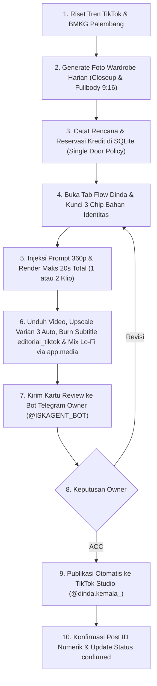

# Panduan Standar Produksi Video AI — Dinda Kemala
Akun Resmi: @dinda.kemala_ | Karakter: Dinda Kemala (Palembang Lifestyle & Kuliner)

Dokumen ini adalah SOP tunggal yang sah untuk seluruh siklus produksi konten video harian Dinda Kemala.
Dilarang memotong alur verifikasi wajah, menggunakan prompt tanpa referensi identitas, atau mempublikasikan video tanpa verifikasi ACC Telegram.

---

## 1. Identitas Visual & Karakteristik Inti

1. **Wajah & Proporsi Asli:**
   * Wajah Dinda Kemala mengacu 100% pada berkas master: `FOTO_KARAKTER/Dinda/_Kemala_Three-Expression_Reference_Sheet-1.png_ccfbeaff.jpg`.
   * Karakteristik wajah: Bentuk wajah oval lembut, senyum manis ramah dengan alis natural, mata hidup dan ekspresif.
   * Tekstur kulit: Matte alami fotorealistis dengan pori-pori halus terlihat nyata. DILARANG keras menghasilkan kulit plastik mengilap (*plastic shine*), kulit lilin (*waxy skin*), atau efek filter kecantikan berlebihan (*glass skin / golden glow*).
   * Nol CGI: Video harus memiliki estetika dokumenter rekaman kamera ponsel cerdas asli (*smartphone vlog footage*).
2. **Hijab & Aksesori Tetap:**
   * Hijab voal segiempat polos yang dililit rapi di leher dengan warna senada outfit (krem, beige, cokelat muda, atau hitam).
   * Aksesori wajib: Kalung rantai tipis dengan liontin cincin emas bundar kecil yang menggantung di dada.
3. **Format & Sudut Pandang:**
   * Rasio vertikal 9:16 (generate Google Flow wajib **360p**, lalu di-upscale lokal ke 1080x1920 Full HD dengan Varian 3 Hybrid Foto-Realistik).
   * Pembingkaian satu subjek terpusat (*medium shot / medium close-up*), kamera stabil dengan sedikit goyangan mikro alami khas vlog handheld.

---

## 2. Aturan Keras Google Flow (Protokol Anti-Hilang Muka)

Insiden hilangnya wajah asli Dinda pada iterasi sebelumnya disebabkan oleh penghapusan elemen chip referensi di editor perintah Google Flow. Seluruh skrip otomasi WAJIB mematuhi aturan berikut:

1. **Tiga Bahan Wajib (*Mandatory Ingredients*):**
   * Chip 1: `ccfbeaff` (Master Face Sheet Dinda Tiga Ekspresi).
   * Chip 2: `d7da96d8` (Turnaround Sheet Dinda).
   * Chip 3: `e2dde14c` (Fullbody OOTD Reference).
2. **Larangan Reset Buta Editor:**
   * Dilarang menjalankan perintah `document.execCommand('selectAll')` diikuti `delete` jika menghapus container chip di `.ProseMirror`.
   * Setelah teks diisi, skrip otomasi wajib memverifikasi ketersediaan chip referensi Dinda (`hasDindaFace: true`). Jika chip hilang, sistem harus membuka menu bahan dan menyematkannya kembali sebelum klik generate.
3. **Pengaturan Durasi & Model:**
   * Model: `Omni 1.2 Flash` (atau `Omni 1.1 Flash` sebelum 5 Des), resolusi generate wajib **360p**.
   * Durasi: Fleksibel hingga maksimal **20 detik** per video (1 klip atau gabungan 2 klip `360p` dirakit lokal). Jadwal posting maksimal **1 kali per hari**.
   * Jumlah output: x1 atau x2 sesuai alokasi kredit yang direservasi di SQLite.

---

## 3. Sistem Lemari Pakaian Harian (*Daily Wardrobe Pipeline*)

1. **Rotasi Outfit Harian:**
   * Setiap slot waktu (pagi dan malam) wajib menggunakan busana yang berbeda dan berganti setiap hari.
   * Gaya busana disesuaikan dengan konteks aktivitas:
     * **Pagi Hari:** *Morning casual* (kemeja oversized linen mocha/sage, celana kulot ivory, hijab voal beige).
     * **Sore/Kafe:** *Casual aesthetic* (blus crinkle linen, knit cardigan pastel, celana palazzo).
     * **Malam Hari:** *Evening cozy* (sweater rajut bergaris taupe atau soft minimalist blazer).
2. **Aset Foto Fisik Wajib di Disk:**
   * Sebelum video Flow dibuat, lemari pakaian harus memiliki 2 foto referensi resolusi 768x1376:
     * `characters/dinda/wardrobe/<outfit_id>/closeup_portrait_916.jpg`
     * `characters/dinda/wardrobe/<outfit_id>/fullbody_ootd_916.jpg`
   * Status outfit di tabel SQLite `character_wardrobe` wajib bernilai `active`.

---

## 4. Formula Audio & Tata Suara (*Audio Engineering*)

1. **Dialog Native di Flow & Contextual 3-Layer Hook:**
   * Dialog diucapkan langsung oleh Dinda di dalam video dengan sinkronisasi bibir (*lip-sync*) yang natural.
   * **Formula Pembuka 0–3 detik (Contextual Hook):** Menghubungkan momen nyata harian / kabar kuliner hangat tanpa basa-basi clickbait klise (mis. *"Pagi ini Palembang lagi gerimis adem, dan ternyata semangkuk burgo kuah santan yang kita makan ini kemarin baru aja bawa pulang juara kompetisi masak nasional..."*).
   * **Penutup & CTA Komentar:** Diakhiri pertanyaan komparasi dua kubu untuk memicu perdebatan ramah di kolom komentar (*"Kalian tim burgo kuah santan atau tekwan?"*).
   * Bahasa: Bahasa Indonesia santai dan akrab dengan sentuhan sapaan khas Palembang ("Halo lur!", "Peh kito...", "wong kito galo").
2. **Pencampuran Musik Latar (*Audio Mixing*):**
   * Video mentah hasil Flow digabungkan dengan musik latar lo-fi akustik khas Palembang (`characters/dinda/content/sore_palembang_lofi_acoustic.wav`).
   * Filter ducking FFmpeg: Musik latar diturunkan volumenya ke kisaran **-16 dB** (`0.15`) saat Dinda berbicara agar artikulasi vokal tetap jernih dan renyah.
   * **Aturan Kontinuitas Properti (Anti-Barang Muncul & Hilang):** Setiap barang (gelas, piring, tas, sendok, atau produk) dalam 1 klip WAJIB hadir konsisten sejak `0.0s` hingga akhir klip; hindari perpindahan atau kemunculan mendadak benda baru di tengah adegan.
4. **Upscale Hybrid Varian 3 & Subtitle 2-Tier Editorial TikTok Tanpa Koma (Wajib di Pasca-Produksi):**
   * Frame mentah hasil generate Google Flow `360p` tetap wajib bebas dari teks bawaan AI (`no burned-in AI text`, `no watermark`).
   * Di tahap pasca-produksi lokal (`app/upscaler.py` -> `app/subtitles.py` via `app/media.py --character dinda`), video `360p` ditingkatkan otomatis ke `1080x1920` dengan **Varian 3 Hybrid Foto-Realistik** (`55% upscayl-lite-4x + 45% Lanczos CAS + micro grain`, `texture_preserve=0.45`), lalu dibakar hardsub terpadu **`editorial_tiktok`** tanpa tanda koma (`Ray_Top` putih `#FFFFFF` Helvetica Neue Bold 44 ALL CAPS `y=1502` + `Ray_Bot` kuning limau `#E8FF3B` Times New Roman 126 `ScaleX=72` lowercase `y=1595`).

---

## 5. Template Prompt Google Flow Resmi

### Template Slot Pagi / Jalan-Jalan & Budaya:
```text
Authentic handheld smartphone vlog video of Dinda Kemala, the exact same Indonesian woman shown in all attached reference images. Output exactly one woman, never a collage, split screen or reference-sheet layout. Vertical 9:16, one continuous shot, medium close-up standing outside at [LOKASI_PALEMBANG] in the soft morning daylight.

She is wearing her new morning outfit: [DESKRIPSI_OUTFIT_LENGKAP], with a neat soft beige voal hijab and a delicate gold ring necklace. Daylight neutral white balance at 5500K, true-to-life colors, realistic matte human skin with visible fine pores, no plastic shine, no waxy skin, no glass skin, zero CGI, authentic non-AI documentary look.

She smiles warmly at the camera, speaks naturally to the lens with clear lip-sync about [TOPIK_VLOG_PAGI], gesturing gently with her hand. Handheld vertical 9:16 framing, subject centered, stable face, natural micro-expressions, honest morning street-vlog atmosphere, no text overlay, no logo.
```

### Template Slot Malam / Kuliner & Cozy Vlog:
```text
Authentic handheld smartphone vlog video of Dinda Kemala, the exact same Indonesian woman shown in all attached reference images. Output exactly one woman, never a collage, split screen or reference-sheet layout. Vertical 9:16, one continuous shot, medium close-up sitting at [LOKASI_KULINER_MALAM_PALEMBANG] in the evening.

She is wearing her evening outfit: [DESKRIPSI_OUTFIT_MALAM], with a neat voal hijab and her signature delicate gold ring necklace. Warm practical evening lights balanced to neutral white, true-to-life colors, realistic matte human skin with visible fine pores, zero plastic shine, zero CGI, authentic non-AI documentary look.

She smiles warmly at the camera, takes a small bite or points at the warm local dish, speaks naturally to the lens with clear lip-sync about [TOPIK_KULINER_MALAM]. Handheld vertical 9:16 framing, subject centered, stable face, natural micro-expressions, honest evening vlog atmosphere, no text overlay, no logo.
```

---

## 6. Alur Operasional Produksi End-to-End



---

## 7. Kebijakan Kepatuhan & Keamanan

1. **Single Door Policy:** Tidak boleh ada tombol generate di Flow yang ditekan tanpa reservasi `generation_jobs` aktif di SQLite.
2. **Gerbang Persetujuan Wajib:** Dilarang mengunggah konten ke TikTok sebelum mendapat persetujuan ACC yang sah dari Owner melalui Telegram.
3. **Kebijakan 0% Emoji:** Seluruh prompt, caption TikTok, tagar, dan log sistem wajib 100% bebas dari karakter emoji.
